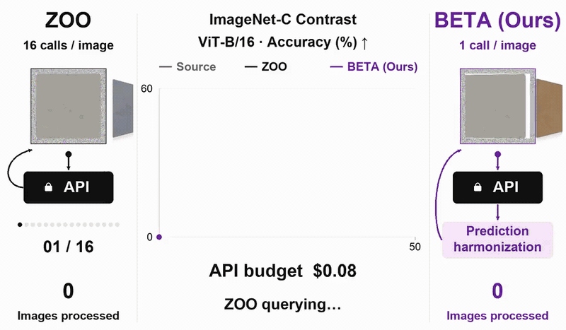
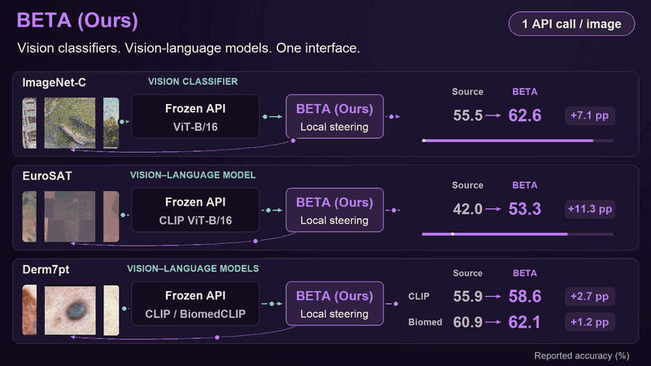
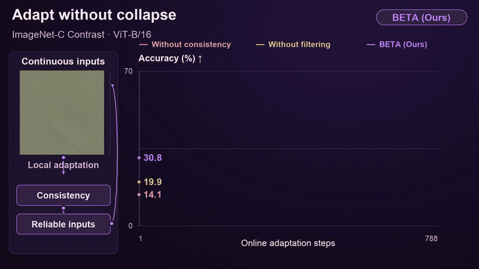
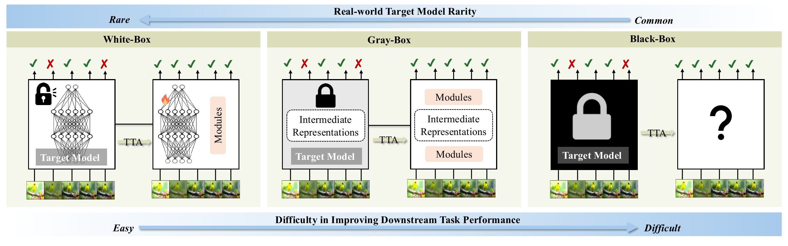
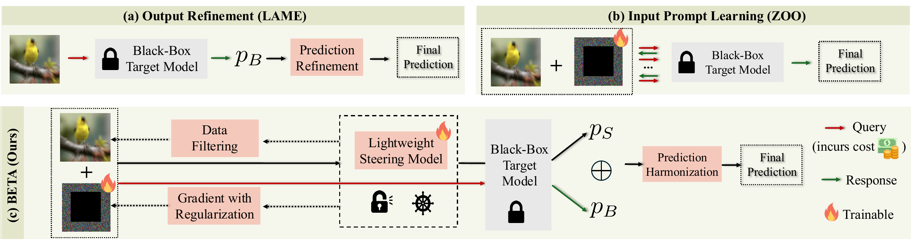

# Adapting in the Dark: Efficient and Stable Test-Time Adaptation for Black-Box Models

<p align="center">
  <b>NeurIPS 2026</b> &nbsp; | &nbsp; 🏆 <b>ICLR 2026 TTU Workshop &middot; Best Paper Award</b>
</p>


<p align="center">
  
  <a href="https://arxiv.org/pdf/2604.15609"></a>
  <a href="https://openreview.net/forum?id=v56b8I1tua"></a>
  <a href="https://yunbeizhang.github.io/BETA/"></a>
  <a href="LICENSE"></a>
</p>
<p align="center">
  <b>Yunbei Zhang&nbsp;&nbsp;&emsp;&emsp;Shuaicheng Niu&nbsp;&nbsp;&emsp;&emsp;Chengyi Cai&nbsp;&nbsp;&emsp;&emsp;Feng Liu&nbsp;&nbsp;&emsp;&emsp;Jihun Hamm</b>
</p>


## News

- **2026.** Accepted to **NeurIPS 2026**.

- 🏆 **Apr 27, 2026.** Received the **Best Paper Award** at the Third Workshop on Test-Time Updates (TTU).
- **Apr 16, 2026.** Code released.
- 🏆 **Mar 07, 2026.** Selected as **Oral Presentation** at the Third Workshop on Test-Time Updates (TTU).
- **Mar 01, 2026.** Accepted to the Third Workshop on Test-Time Updates (TTU), ICLR 2026 Workshop.

## BETA in motion

BETA adapts frozen prediction-only APIs through a lightweight local steering model, with **one API call per test image**. It works with **vision classifiers and vision-language models**, including **CLIP and BiomedCLIP**.

### Same budget. More images.

<p align="center"></p>

The current homepage demo: a dedicated local ImageNet-C Contrast replay, with the learned prompt, API loop, accuracy and images processed shown together. The full $50 query budget processes **15,625 images with BETA versus 976 with ZOO**. Dollar values convert local query counts at the paper’s unit price. [MP4](assets/video/beta-budget.mp4)

### Vision classifiers and vision-language models

<p align="center"></p>

| Model family | Black-box target | Dataset | Source | BETA | Gain |
|---|---|---|---:|---:|---:|
| Vision classifier | ViT-B/16 | ImageNet-C | 55.5 | **62.6** | +7.1 pp |
| Vision-language model | CLIP ViT-B/16 | EuroSAT | 42.0 | **53.3** | +11.3 pp |
| Vision-language model | CLIP ViT-B/16 | Derm7pt | 55.9 | **58.6** | +2.7 pp |
| Vision-language model | BiomedCLIP | Derm7pt | 60.9 | **62.1** | +1.2 pp |

Reported final accuracy (%); each BETA setting uses **one API call per image**. The video uses representative real inputs to illustrate the shared interface. [MP4](assets/video/beta-model-families.mp4)

### Keep learning. Avoid collapse.

<p align="center"></p>

The original paper’s Contrast ablation curves show why **consistency regularization** and **prompt-oriented filtering** matter for stable online adaptation. [MP4](assets/video/beta-stability.mp4)

All three GIFs loop continuously in the README; the [project page](https://yunbeizhang.github.io/BETA/#demos) uses silent looping MP4s. [Media sources and reproduction](docs/media/README.md).

## TODO

- [x] Release code
- [x] [arXiv preprint](https://arxiv.org/pdf/2604.15609)

## Abstract

<p align="center">
  
</p>

Test-Time Adaptation (TTA) for black-box models accessible only via APIs remains a largely unexplored challenge. Existing approaches such as post-hoc output refinement offer limited adaptive capacity, while Zeroth-Order Optimization (ZOO) enables input-space adaptation but faces high query costs and optimization challenges in the unsupervised TTA setting. We introduce **BETA** (Black-box Efficient Test-time Adaptation), a framework that addresses these limitations by employing a lightweight, local white-box *steering model* to create a tractable gradient pathway. Through a *prediction harmonization* technique combined with *consistency regularization* and *prompt learning-oriented filtering*, BETA enables stable adaptation with no additional API calls and negligible latency beyond standard inference. On ImageNet-C, BETA achieves a **+7.1% accuracy gain on ViT-B/16** and **+3.4% on CLIP**, surpassing strong white-box and gray-box methods including TENT and TPT. On a commercial API, BETA achieves comparable performance to ZOO at **250&times; lower cost** while maintaining real-time inference speed.

## Method Overview

<p align="center">
  
</p>

BETA operates with two models, a powerful frozen black-box target `f_B` and a lightweight local *steering model* `f_S`, and learns an additive visual prompt `δ` that is optimized locally through `f_S`. Because direct gradient transfer between architectures is ineffective, BETA uses **prediction harmonization** to fuse the two outputs into a shared objective. Two stabilizers, namely **consistency regularization** between clean and prompted predictions, and **prompt-learning-oriented filtering**, keep the unsupervised adaptation stable.

## Installation

```bash
git clone https://github.com/yunbeizhang/BETA.git
cd BETA
conda create -n beta python=3.10 -y
conda activate beta
pip install -r requirements.txt
```

## Data Preparation

BETA evaluates on ImageNet-C (Hendrycks & Dietterich, 2019). Download it and set the data roots via the `DATA_DIR` environment variable (see `main.sh`):

```
DATA_DIR/
├── ImageNet/            # original validation set
└── ImageNet-C/          # 15 corruptions × 5 severities
```

Optional domain-shift benchmarks (ImageNet-R / V2 / Sketch / -A) can be placed alongside and passed via `--data_rendition`, `--data_v2`, etc.

## Quick Start

Run BETA with the reference ViT-B/16 configuration:

```bash
bash main.sh
```

## Citation

If you find this work useful, please cite:

```bibtex
@inproceedings{zhang2026adapting,
  title={Adapting in the Dark: Efficient and Stable Test-Time Adaptation for Black-Box Models},
  author={Yunbei Zhang and Shuaicheng Niu and Chengyi Cai and Feng Liu and Jihun Hamm},
  booktitle={Advances in Neural Information Processing Systems},
  year={2026},
  url={https://arxiv.org/abs/2604.15609}
}
```

## Acknowledgements

This repository builds on [FOA](https://github.com/mr-eggplant/FOA), [BayesianLM](https://github.com/tmlr-group/BayesianLM), and [AReS](https://github.com/yunbeizhang/AReS). Thanks to the authors for open-sourcing their code.

## License

This project is released under the [Apache 2.0 License](LICENSE).
